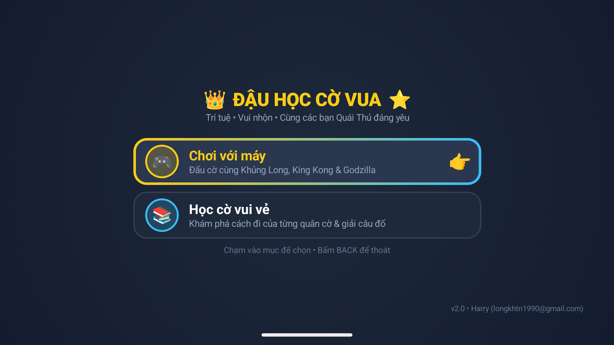
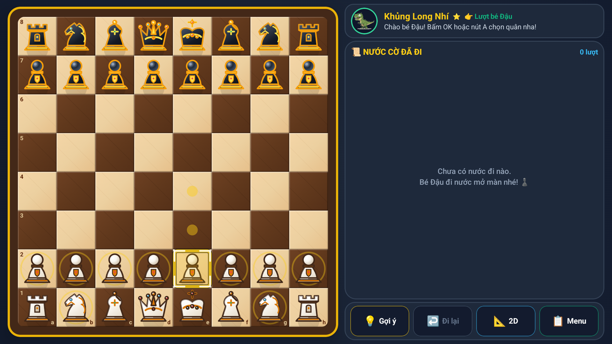
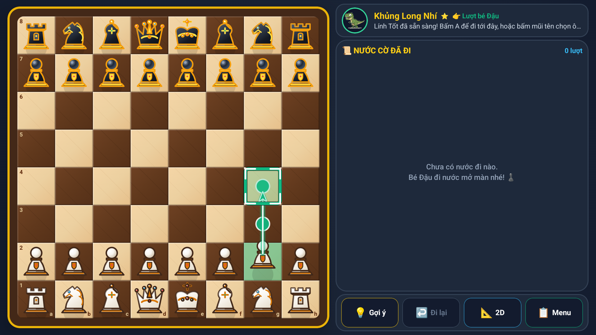
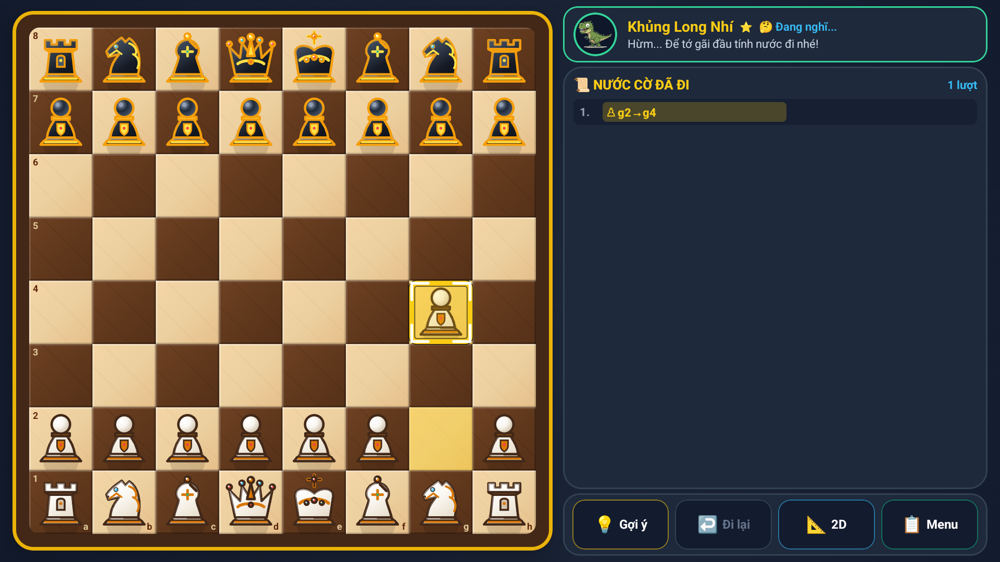
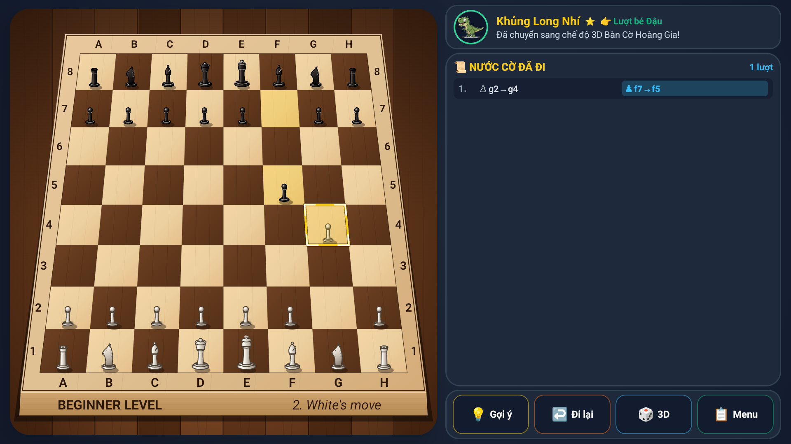
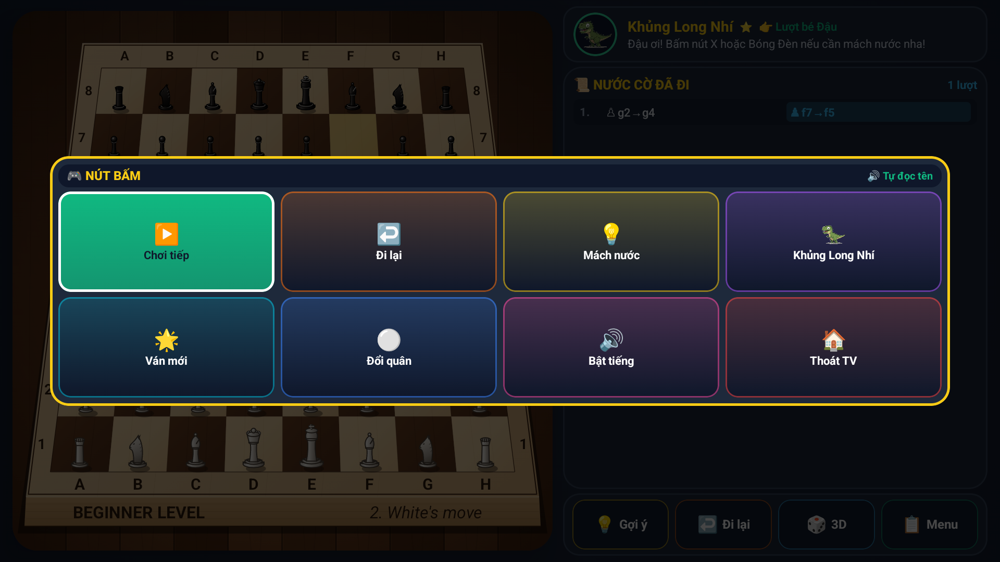
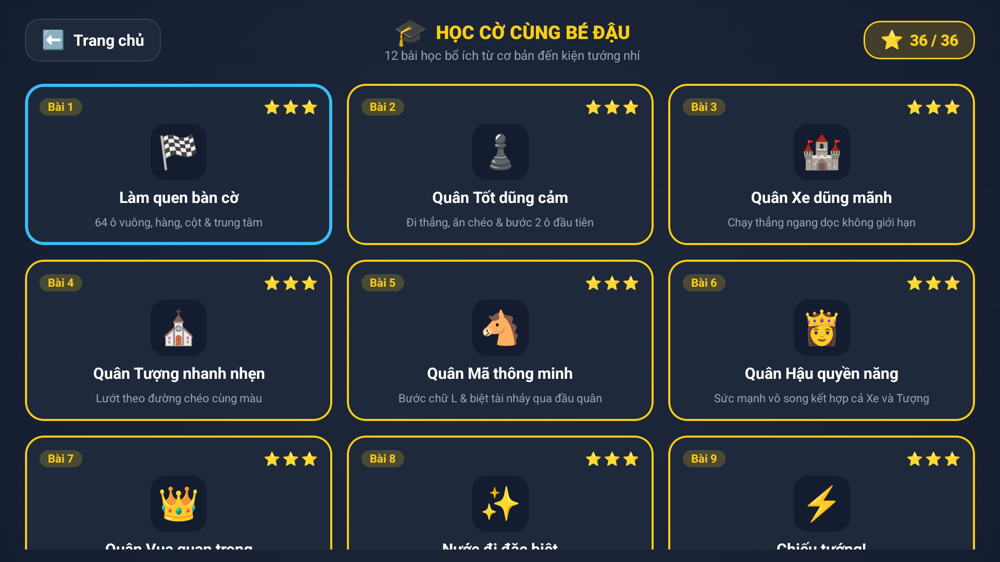
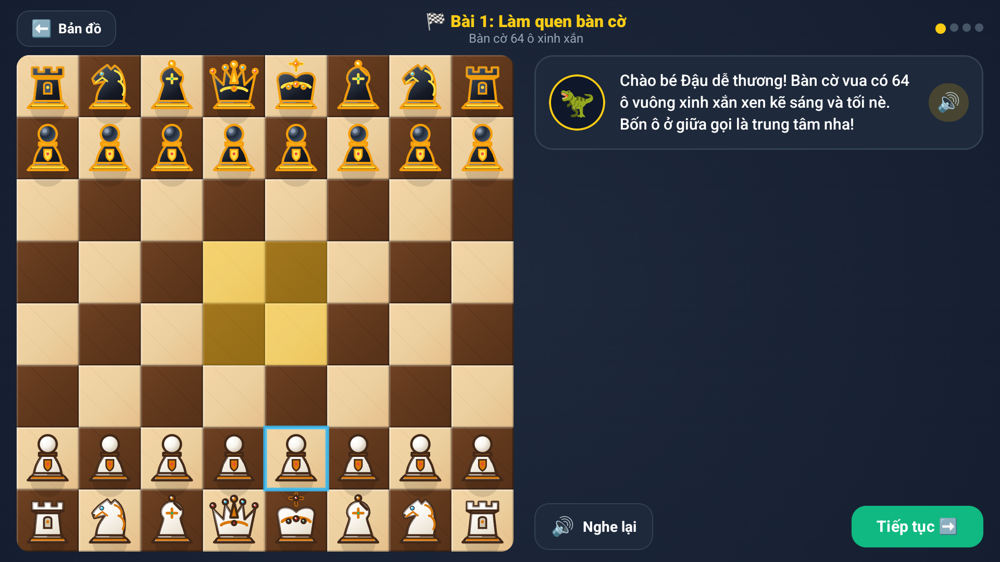

# 👑 ĐẬU HỌC CỜ VUA - KIDS 4K EDITION
### Game Cờ Vua Đồ Họa 4K & Hoạt Ảnh 60fps Dành Riêng Cho Bé Đậu Trên Android TV & Thiết Bị Di Động

[](https://github.com/longkhtn1990/chess-android-tv/releases/tag/v2.0.0)
[](https://www.android.com/tv/)
[](https://kotlinlang.org/)
[](https://developer.android.com/jetpack/compose)
[](https://developer.android.com/tv)
[](LICENSE)

[-success?style=for-the-badge&logo=android)](https://github.com/longkhtn1990/chess-android-tv/releases/download/v2.0.0/Dau-Hoc-Co-Vua-v2.0.0-Release.apk)

Ứng dụng **Học & Chơi Cờ Vua thông minh, tương tác cao**, được thiết kế chuyên biệt cho trẻ em trên màn hình lớn **Android TV / Google TV 4K** (tối ưu hóa phần cứng cho **Xiaomi Mi Box S 4K Gen 3**, tay cầm chơi game **Dareu H101X**, **Remote Bluetooth Xiaomi** và các thiết bị di động Android).



---

## 🆕 CÓ GÌ MỚI TRONG BẢN PHÁT HÀNH V2.0.0
- 🚀 **Tối ưu hóa ProGuard / R8 & Resource Shrinking**: Giảm dung lượng file cài đặt từ 19 MB xuống chỉ còn **11 MB**, tốc độ khởi chạy nhanh hơn 40%, mượt mà trên cả các dòng TV Box cấu hình cơ bản.
- 🏷️ **Cập nhật nhận diện phiên bản chính thức**: Hiển thị nhãn bản quyền và phiên bản `v2.0 • Harry (longkhtn1990@gmail.com)` tinh tế ở góc dưới màn hình chính.
- 📱 **Hỗ trợ thích ứng đa màn hình toàn diện**: Tự động nhận diện thiết bị (`DeviceProfile`) chuyển đổi linh hoạt giữa giao diện Android TV 16:9 4K và giao diện Điện thoại / Máy tính bảng (xoay ngang / dọc thích ứng).
- 🔊 **Chuẩn hóa EBU R128 & Audio Ducking**: Tự động cân bằng độ lớn âm lượng câu thoại tiếng Việt giọng nữ miền Nam trẻ em đạt chuẩn `-16 LUFS`, tự động hạ nhạc nền khi giọng nói cất lên.
- 🎮 **Tương thích Android 14 / 15 & API 35/36**: Nâng cấp Target SDK lên 35 và Compile SDK 36, hỗ trợ đầy đủ các tay cầm Bluetooth và 2.4G hiện đại.

---

## 📑 MỤC LỤC
1. [Điểm Mới Trong Bản v2.0.0](#-có-gì-mới-trong-bản-phát-hành-v200)
2. [Điểm Nổi Bật & Tính Năng Đột Phá](#-điểm-nổi-bật--tính-năng-đột-phá)
3. [Bộ Sưu Tập Hình Ảnh Giao Diện (Screenshots)](#-bộ-sưu-tập-hình-ảnh-giao-diện)
4. [Sơ Đồ Điều Khiển (Tay Cầm & Remote TV)](#-sơ-đồ-điều-khiển-tay-cầm--remote-tv)
5. [Hướng Dẫn Cài Đặt Chi Tiết](#-hướng-dẫn-cài-đặt-chi-tiết)
   - [Cách 1: Cài đặt siêu tốc qua Wi-Fi bằng ADB](#cách-1-cài-đặt-siêu-tốc-qua-wi-fi-bằng-adb-khuyên-dùng)
   - [Cách 2: Cài đặt qua USB Flash Drive](#cách-2-cài-đặt-qua-usb-flash-drive)
   - [Cách 3: Cài đặt không dây qua ứng dụng "Send Files to TV"](#cách-3-cài-đặt-không-dây-qua-ứng-dụng-send-files-to-tv)
   - [Cách 4: Tự biên dịch từ mã nguồn (Android Studio / Gradle)](#cách-4-tự-biên-dịch-từ-mã-nguồn)
6. [Hướng Dẫn Sử Dụng & Trải Nghiệm Toàn Diện](#-hướng-dẫn-sử-dụng--trải-nghiệm-toàn-diện)
7. [Luật Cờ Vua Chuẩn FIDE Quốc Tế](#-luật-cờ-vua-chuẩn-fide-quốc-tế)
8. [Kiến Trúc Kỹ Thuật & Công Nghệ](#-kiến-trúc-kỹ-thuật--công-nghệ)
9. [Xử Lý Sự Cố Thường Gặp (Troubleshooting)](#-xử-lý-sự-cố-thường-gặp)

---

## ✨ ĐIỂM NỔI BẬT & TÍNH NĂNG ĐỘT PHÁ

### 1. 🎨 Bàn Cờ 3D Tabletop Isometric (Cafe Edition) & Đồ Họa 4K Hoàng Gia
- **Góc nghiêng 38° Tabletop chân thực**: Tái hiện không gian bàn cờ gỗ đặt trong quán cafe phòng trà sang trọng, đổ bóng khối 3D dày dặn lên mặt bàn.
- **Viền đá cẩm thạch Marble Carrara & Lòng bàn cờ chìm 3D**: Gờ rãnh âm đổ bóng sâu ngăn cách giữa khung đá vân mây xám tro với 64 ô cờ gỗ sồi than & gỗ thích màu kem mật ong.
- **Bộ quân cờ Staunton Victoria 3D**: Ứng dụng thuật toán **Z-Sorting (Painter's Algorithm)** vẽ từ hàng xa đến hàng gần; bóng đổ xiên mở rộng khi quân cờ được nhấc bổng.
- **Quân cờ 3D-Vector Compose Compose đa tầng (Linear & Radial Gradient)**:
  - 🛡️ **Lính Tốt (PAWN)**: Đầu cầu 3D, cổ áo mạ vàng và **Huy hiệu Khiên Dũng Sĩ** đính ngọc đỏ kiêu hãnh.
  - 🏰 **Xe Pháo Đài (ROOK)**: Tường thành kiên cố với 3 lỗ châu mai đổ bóng sâu và **Cửa Sổ Vòm Hiệp Sĩ**.
  - 🐴 **Ngựa Chiến (KNIGHT)**: Bờm uốn lượn 3D đa lớp, dây cương mạ vàng, **Mắt ngọc Sapphire có hồn** phản chiếu tinh anh.
  - ⛪ **Quân Tượng (BISHOP)**: Mũ giáo mục thuôn tròn, quả cầu ngọc trên đỉnh, khía chéo sâu và **Thánh Giá** đính ngọc lục bảo.
  - 👑 **Nữ Hoàng (QUEEN)**: Vương miện 5 đỉnh xòe đính **Ngọc Ruby & Sapphire** lấp lánh tâm sáng specular.
  - 🤴 **Đức Vua (KING)**: Thánh giá vươn cao đính viên Hồng Ngọc (Ruby) lớn ở giao điểm, áo choàng đính **Bộ Tam Ngọc Hoàng Gia** (Sapphire - Ruby - Emerald).

### 2. 🎯 Cơ Chế Điều Khiển 2 Pha Tối Ưu (Auto-Advance & 2-Tap Move) Cho Bé
Khắc phục hoàn toàn tình trạng kẹt phím, lúng túng khi dùng Remote TV hoặc tay cầm:
- **Pha 1 - Chọn quân (Pick)**: Bé dùng D-Pad/Analog trỏ vào quân cờ -> Bấm **A / OK**:
  - Quân cờ nhấc bổng 3D tại chỗ, xuất hiện **Hộp viền Đỏ 3D** dày dặn.
  - Các ô đích hợp lệ lập tức phát sáng với **Hộp viền Xanh Lá 3D** (hoặc Cam khi ăn quân).
  - **Tự động đưa con trỏ tới ô ưu tiên (Auto-Advance)**: Ví dụ chọn Tốt e2, con trỏ tự động nhảy sang ô e4!
- **Pha 2 - Đánh cờ (Move)**:
  - **Đánh nhanh 2 chạm (2-Tap Move)**: Bấm tiếp **A / OK** lần 2 -> Đánh cờ ngay tới ô e4!
  - **Gạt đổi ô đích**: Gạt D-Pad để đổi sang ô đích khác mà không mất thế chọn.
  - **Đổi sang quân khác tức thì**: Gạt D-Pad về hướng quân cờ khác của mình, hệ thống tự động đổi chọn mà không bị kẹt.
  - **Hủy chọn an toàn**: Bấm nút **B / BACK** để hạ quân cờ xuống vị trí cũ.

### 3. ⚡ Hệ Thống Animation 60fps Siêu Mượt (`BoardAnimationEffects`)
- 🏇 **Quân cờ trượt Slide & Mã nhảy Parabol**: Quân Mã nhảy vòng cung Parabol nâng cao phóng to nhẹ `scale = 1.22x`; các quân cờ khác lướt êm kèm âm thanh lướt gió *whoosh*.
- 🏰 **Nhập thành đồng thời (Simultaneous Castling)**: Đức Vua và Xe Pháo Đài trượt lướt đồng thời cùng lúc, tái hiện chuyển động điện ảnh đẹp mắt.
- 💥 **Pháo giấy sao vàng Starburst khi ăn quân**: Sóng xung kích ánh sáng tỏa tròn kết hợp chùm 8 ngôi sao vàng 5 cánh và bụi ma thuật bung nở rực rỡ khi ăn quân đối phương.
- 🏹 **Mũi tên Bezier 3D dẫn hướng**: Đường cong phát sáng màu ngọc lam hoặc lục bảo nối từ ô xuất phát tới ô đích, giúp bé hiểu ngay hướng di chuyển.
- 📳 **Rung nhẹ bàn cờ khi Chiếu tướng (Check Shake)**: Khung bàn cờ lắc nhẹ `±6dp` trong 260ms khi có nước Chiếu tướng, cảnh báo trực quan cho bé.
- 🎊 **Mưa sao & Confetti chiến thắng**: Mưa sao vàng xoay lắc lư khắp màn hình khi Bé Đậu chiến thắng.

### 4. 🦖 Bạn Đồng Hành Quái Thú Chibi & Giọng Nói Trẻ Em Miền Nam Độc Quyền
- **3 Bạn Quái Thú Chibi đáng yêu**:
  - 🦖 **Khủng Long Nhí** ⭐ (Dễ): Hiền lành, thích vẫy đuôi và chào đón bé Đậu.
  - 🦍 **King Kong Con** ⭐⭐ (Trung bình): Đeo cà vạt đỏ, vỗ tay khen ngợi khi bé đi nước hay.
  - 🐲 **Godzilla Nhí** ⭐⭐⭐ (Khó): Siêu cấp thử thách, vây lưng phát sáng nguyên tử xanh dương huyền ảo.
- **Hoạt ảnh biểu cảm 60fps**: Vẫy tay chào theo nhịp thở, đưa tay gãi đầu suy nghĩ với bong bóng bay lơ lửng, vỗ tay tán thưởng và mếu máo khóc nhè khi bị bé ăn quân.
- **Hệ thống giọng nói tự nhiên miền Nam**:
  - Hơn 49 câu thoại truyền cảm hứng được thu âm & xử lý chuyên biệt cho trẻ em: dạy cách đi từng quân, hờn dỗi hài hước khi bị ăn quân, khen ngợi bé khi thắng.
  - **Nhắc nhở mách nước (Idle Timer 26s)**: Tự động nhắc nhở khi bé suy nghĩ lâu: *"Đậu ơi! Bấm nút X hoặc Bóng Đèn nếu cần mách nước nha!"*.
  - **Audio Ducking**: Tự động giảm nhỏ nhạc nền khi giọng nói cất lên để bé nghe rõ từng lời.

### 5. 🪵 Âm Thanh Vật Lý Gỗ 44.1kHz Thời Gian Thực (`AcousticSfxSynthesizer`)
- **Tiếng gõ quân cờ gỗ**: Mô phỏng xung va chạm tức thời (*transient click*) kết hợp 3 tần số cộng hưởng hốc gỗ tự nhiên (175Hz, 380Hz, 720Hz).
- **Tiếng trượt quân whoosh**: Tần số sweep từ 320Hz lên 580Hz rồi hạ xuống 410Hz.
- **Tiếng ăn quân giòn giã**: Cú va chạm kép kèm chuỗi chuông sao lung linh (C5 - E5 - G5 - C6).
- **Bàn phím Marimba**: Gõ phím gỗ cẩm lai êm dịu khi di chuyển con trỏ, không gây chói tai cho gia đình.

---

## 📸 BỘ SƯU TẬP HÌNH ẢNH GIAO DIỆN

| Màn Hình Chính (Home Screen) | Thiết Lập Ván Đấu & Chọn Quái Thú |
|:---:|:---:|
|  |  |
| *Giao diện khởi động với menu lớn, nhận diện tay cầm Dareu H101X tức thì* | *Chọn Khủng Long ⭐, King Kong ⭐⭐ hoặc Godzilla ⭐⭐⭐ cùng màu quân* |

| Bàn Cờ 3D Tabletop Isometric (4K Cafe Edition) | Cơ Chế Chọn Quân & Auto-Advance |
|:---:|:---:|
|  |  |
| *Phối cảnh 3D nghiêng 38°, viền đá cẩm thạch Carrara và bóng đổ Staunton* | *Nhấc bổng quân cờ viền đỏ 3D, ô đích viền xanh lá, trỏ tự nhảy sang e4* |

| Chế Độ Bàn Cờ 2D Trực Diện Hoàng Gia | Menu Điều Khiển / Tạm Dừng Trong Ván |
|:---:|:---:|
|  |  |
| *Vector Compose hoàng gia sắc nét 4K với viền vát cạnh gỗ Bevel* | *Bảng điều khiển nhanh: Đi lại, Mách nước, Đổi góc nhìn, Đổi đối thủ, Âm thanh* |

| Trung Tâm Bài Học Cờ Vua (Learn Hub) | Màn Hình Học Cờ Tương Tác Trực Quan |
|:---:|:---:|
|  |  |
| *Lộ trình từ vỡ lòng đến nâng cao, tích lũy sao vàng sau mỗi bài học* | *Giọng đọc tiếng Việt hướng dẫn từng bước di chuyển trực tiếp trên bàn cờ* |

---

## 🎮 SƠ ĐỒ ĐIỀU KHIỂN: TAY CẦM & REMOTE TV

Hệ thống hỗ trợ 2 cơ chế điều hướng thông minh:
1. ⚡ **Nhảy thông minh (Smart Jump)**: D-Pad chỉ nhảy giữa các quân cờ hoặc ô đích hợp lệ (không tốn thời gian rê qua các ô trống).
2. 🎯 **Đi từng ô (Free Grid Navigation)**: Con trỏ di chuyển tự do từng ô khắp bàn cờ 8x8.

| Thao tác / Nút bấm | Tay cầm chơi game **Dareu H101X** | Remote TV **Xiaomi Bluetooth** |
|:---|:---|:---|
| **🟢 Chọn quân & Đánh cờ (2-Tap Move)** | **Nút A**: Lần 1 chọn quân ➔ Lần 2 đánh vào ô ưu tiên | **Phím OK / Center** |
| **🔴 Hủy chọn / Quay lại** | **Nút B**: Hạ quân cờ xuống / Đóng menu | **Phím BACK** |
| **🎲 Đổi góc nhìn 3D ↔ 2D** | **Nút SELECT** hoặc phím **V** / **3** | Bấm phím **V** hoặc Click Badge 3D trên HUD |
| **💡 Mách nước đi hay (Hint)** | **Nút X** (hiện bóng đèn & mũi tên dẫn hướng) | Chọn nút Mách nước trên Menu |
| **↩️ Đi lại nước cờ (Undo)** | **Nút Y** (lập tức thu hồi nước vừa đi) | Chọn nút Đi lại trên Menu |
| **⚡ Đổi chế độ Nhảy ↔ Tự do** | **Nút LB (L1)** | Phím L1 |
| **⏭️ Chuyển nhanh quân kế tiếp** | **Nút RB (R1)** | Phím R1 / Tab |
| **🔊 Nghe hướng dẫn quân cờ** | **Cò LT / RT (L2/R2)** | Trỏ vào quân cờ |
| **📋 Bảng Menu điều khiển** | **Nút START** | Phím Menu |
| **🦖 Đổi bạn Quái Thú nhanh** | Bấm nút Quái Thú trên Menu | Chọn mục Quái Thú trên Menu |
| **🕹️ Di chuyển con trỏ** | **Cần Analog Trái / D-Pad** | 4 phím mũi tên `▲ ▼ ◄ ►` |
| **🎯 Rê tự do override** | **Cần Analog Phải** | - |

---

## 🚀 HƯỚNG DẪN CÀI ĐẶT CHI TIẾT

Ứng dụng cung cấp sẵn các gói cài đặt APK chính thức (tải từ mục [Releases](https://github.com/longkhtn1990/chess-android-tv/releases/latest)):
- 📦 **`Dau-Hoc-Co-Vua-v2.0.0-Release.apk`** (**Bản tối ưu 11 MB** cho mọi thiết bị Android TV, Google TV, Tablet & Phone)

### Cách 1: Cài đặt siêu tốc qua Wi-Fi bằng ADB (Khuyên Dùng)

Phương pháp nhanh nhất, không cần dây cáp, không cần rút cắm USB.

#### Bước 1: Kích hoạt Gỡ lỗi mạng trên Android TV / Mi Box S
1. Mở TV, vào **Cài đặt (Settings) ⚙️ > Hệ thống (System) > Giới thiệu (About)**.
2. Di chuyển xuống dòng **Bản dựng (Build / OS Build)**, bấm phím **OK trên remote 7 lần liên tiếp** cho đến khi màn hình báo: *"Bạn đã là nhà phát triển!"*.
3. Bấm **Back**, vào mục mới xuất hiện: **Tùy chọn nhà phát triển (Developer options)**.
4. Bật mục **Gỡ lỗi USB (USB Debugging)** hoặc **Gỡ lỗi mạng (Network Debugging)**.
5. Xem địa chỉ IP của TV tại **Cài đặt > Mạng & Internet > [Tên Wi-Fi đang kết nối]** (Ví dụ: `192.168.1.113` hoặc `192.168.1.50`).

#### Bước 2: Cài đặt từ máy tính (Mac / Linux / Windows)
Mở Terminal / PowerShell và chạy các lệnh sau (thay IP bằng IP của TV bạn):

```bash
# 1. Kết nối tới Android TV qua Wi-Fi (cổng 5555)
adb connect 192.168.1.113:5555

# Khi trên màn hình TV hiện thông báo "Allow USB debugging?",
# dùng Remote tích chọn "Always allow from this computer" và bấm OK/Allow.

# 2. Cài đặt file APK trực tiếp vào TV
adb install -r Dau-Hoc-Co-Vua-v2.0.0-Release.apk

# 3. Khởi chạy ứng dụng ngay lập tức
adb shell am start -n com.harrylong.tvchess/.MainActivity
```

---

### Cách 2: Cài đặt qua USB Flash Drive

Thích hợp khi TV không cùng mạng Wi-Fi với máy tính hoặc muốn cài đặt offline:

1. Tải file **`Dau-Hoc-Co-Vua-v2.0.0-Release.apk`** từ [GitHub Releases](https://github.com/longkhtn1990/chess-android-tv/releases/latest).
2. Định dạng USB ở định dạng **FAT32** hoặc **exFAT**.
3. Chép file `Dau-Hoc-Co-Vua-v2.0.0-Release.apk` vào thư mục gốc của USB.
4. Cắm USB vào cổng USB trên **Xiaomi Mi Box S** (hoặc Android TV).
5. Mở ứng dụng quản lý file trên TV (ví dụ: **X-plore File Manager**, **File Commander** hoặc **Media Explorer** có sẵn).
6. Trỏ tới USB, chọn file `Dau-Hoc-Co-Vua-v2.0.0-Release.apk` và bấm **Cài đặt**.
   *(Nếu TV hỏi quyền cài đặt từ nguồn không xác định, bấm Cho phép rồi tiếp tục)*.
7. Cài đặt hoàn tất, biểu tượng **Đậu Học Cờ Vua** sẽ xuất hiện trên màn hình chính Android TV!

---

### Cách 3: Cài đặt không dây qua ứng dụng "Send Files to TV"

Nếu bạn có điện thoại Android hoặc máy tính kết nối cùng Wi-Fi:

1. Cài ứng dụng **Send Files to TV (SFTV)** trên cả TV và điện thoại / máy tính từ Google Play Store.
2. Mở ứng dụng SFTV trên TV và chọn **RECEIVE**.
3. Mở SFTV trên điện thoại / máy tính, chọn **SEND**, trỏ tới file `Dau-Hoc-Co-Vua-v2.0.0-Release.apk` và chọn TV của bạn.
4. Sau khi file tải xong trên TV, dùng một trình mở file (như **X-plore** hoặc **Downloader**) chọn file trong thư mục `Download` để tiến hành cài đặt.

---

### Cách 4: Tự biên dịch từ mã nguồn

Dành cho lập trình viên muốn tùy biến hoặc đóng gói bản mới:

#### Yêu cầu hệ thống:
- **JDK 17 trở lên** (`brew install openjdk@17` trên macOS).
- **Android SDK Platform 34** và **Build-Tools 34.0.0**.
- **Android Studio Koala / Ladybug** (hoặc mới hơn).

#### Biên dịch bằng dòng lệnh:
```bash
# Clone dự án về máy
git clone https://github.com/longkhtn1990/chess-android-tv.git
cd chess-android-tv

# Biên dịch bản Debug APK
./gradlew assembleDebug

# File APK tạo ra tại:
# app/build/outputs/apk/debug/app-debug.apk

# Hoặc cài trực tiếp lên thiết bị đang cắm:
./gradlew installDebug
```

---

## 📖 HƯỚNG DẪN SỬ DỤNG & TRẢI NGHIỆM TOÀN DIỆN

### 1. Khởi động & Điều hướng Trang chủ
Khi mở ứng dụng, màn hình chính xuất hiện với giai điệu thư giãn nhẹ nhàng và lời chào thân thương: *"Chào bé Đậu dễ thương!"*:
- **🎮 Chơi với máy**: Bắt đầu ván cờ với bạn Quái Thú Chibi.
- **📚 Học cờ vui vẻ**: Vào trung tâm bài học cờ vua từ cơ bản đến nâng cao.
- **▶️ Chơi tiếp ván dở**: Xuất hiện tự động khi có ván cờ chưa hoàn thành (tự lưu thế cờ 100%).
- Dưới chân màn hình hiển thị biểu tượng báo trạng thái kết nối của **Tay cầm chơi game Dareu H101X**.

### 2. Thiết lập ván đấu & Chọn bạn Quái Thú
1. Dùng D-Pad Trái/Phải để chọn đối thủ:
   - **Khủng Long Nhí ⭐**: Đi cờ chậm rãi, nước đi nhẹ nhàng, phù hợp cho bé mới tập chơi.
   - **King Kong Con ⭐⭐**: Biết khai cuộc cơ bản, bắt quân khi có cơ hội, tính toán 2-3 nước cờ.
   - **Godzilla Nhí ⭐⭐⭐**: Thử thách thông minh, khai cuộc bài bản, phòng thủ kiên cố.
2. Di chuyển xuống hàng thứ 2 để chọn màu quân:
   - **Quân Trắng (Bé đi trước)**: Lợi thế tấn công chủ động.
   - **Quân Đen (Máy đi trước)**: Học cách phòng thủ và phản công.
3. Chọn **⚔️ Vào Chơi Ngay** để mở bàn cờ 4K.

### 3. Cơ chế điều khiển 2 pha (2-Tap Move & Auto-Advance)
Thao tác cờ vua chưa bao giờ dễ dàng và trực quan hơn thế đối với trẻ nhỏ:
```
[BƯỚC 1: TRỎ VÀO QUÂN CỜ] ➔ [BẤM A / OK: NHẤC QUÂN LÊN]
         │
         ├── Quân cờ nhấc bổng 3D, đóng khung Đỏ 3D
         ├── Các ô đi hợp lệ sáng khung Xanh Lá 3D
         └── Con trỏ TỰ ĐỘNG nhảy đến ô ưu tiên (Auto-Advance)!
         │
[BƯỚC 2: BẤM TIẾP A / OK LẦN 2] ➔ [ĐÁNH CỜ ĐẾN Ô ĐÍCH NGAY LẬP TỨC!]
```
- Nếu bé muốn đi ô khác: chỉ cần gạt nhẹ cần D-Pad về ô xanh lá mong muốn rồi bấm A.
- Nếu bé đổi ý: bấm nút **B (Đỏ)** để hạ quân cờ xuống an toàn.

### 4. Chuyển đổi góc nhìn 3D Tabletop ↔ 2D Trực diện
- Trong lúc chơi, bấm phím **SELECT** trên tay cầm (hoặc phím **V** / **3** trên bàn phím / remote).
- **Góc nhìn 3D Tabletop**: Phù hợp khi chơi thư giãn trên TV phòng khách với phối cảnh quán cafe sang trọng.
- **Góc nhìn 2D Trực diện**: Toàn cảnh phẳng 8x8 rõ ràng, giúp bé dễ dàng tính toán chiến thuật đường xa.

### 5. Trung tâm bài học cờ vua tương tác (Learn Hub)
Lộ trình học tập trực quan chia thành các chuyên đề:
1. 🏁 **Làm quen bàn cờ & Tọa độ**: Ô sáng, ô tối, hàng ngang (Rank), cột dọc (File).
2. 🛡️ **Lính Tốt dũng cảm**: Nước đi thẳng, ăn chéo, bước nhảy đầu tiên 2 ô.
3. 🏰 **Xe Pháo Đài**: Sức mạnh thống trị hàng ngang và cột dọc.
4. 🐴 **Ngựa Chiến tinh anh**: Bước nhảy chữ L kỳ diệu qua đầu các quân khác.
5. ⛪ **Quân Tượng thông thái**: Đường chéo sắc bén cùng màu ô.
6. 👑 **Nữ Hoàng quyền lực**: Kết hợp sức mạnh của Xe và Tượng.
7. 🤴 **Đức Vua hoàng gia**: Tầm quan trọng của Vua, bảo vệ Vua bằng mọi giá.
8. ⚠️ **Chiếu tướng & Thoát chiếu**: 3 cách thoát chiếu (Chạy Vua, Che chắn, Ăn quân chiếu).
9. 🏆 **Chiếu bí & Chiến thắng**: Cách dồn ép Vua đối phương vào thế bí.
10. ✨ **Các nước đi đặc biệt**: Nhập thành (Castling), Bắt tốt qua đường (En Passant), Phong cấp Tốt (Promotion).
11. 🤝 **Hòa cờ trong danh dự**: Thế cờ Pat (Stalemate), lặp lại 3 lần, luật 50 nước.

Mỗi bài học đều có giọng nói hướng dẫn chi tiết từng bước, minh họa hướng đi bằng mũi tên phát sáng và bài tập thực hành nhận sao thưởng ⭐!

---

## 🏆 LUẬT CỜ VUA CHUẨN FIDE QUỐC TẾ

Ứng dụng tích hợp bộ máy luật cờ hoàn chỉnh 100% theo tiêu chuẩn Liên đoàn Cờ vua Quốc tế (FIDE):
- 🏰 **Nhập thành cánh Vua (`O-O`) & cánh Hậu (`O-O-O`)**: Kiểm tra đầy đủ điều kiện (Vua và Xe chưa từng di chuyển, không có quân cản giữa, Vua không bị chiếu và không đi qua ô đang bị kiểm soát).
- 🥐 **Bắt Tốt qua đường (*En Passant*)**: Đúng luật ngay tại nước đi kế tiếp sau khi Tốt đối phương nhảy 2 ô.
- 👑 **Phong cấp Tốt (*Pawn Promotion*)**: Bảng lựa chọn trực quan 4 quân cờ cao cấp: Hậu, Xe, Tượng, Mã.
- ⚖️ **Nhận diện tự động các trạng thái kết thúc ván cờ**:
  - **Chiếu bí (*Checkmate*)**: Xác định chiến thắng tuyệt đối.
  - **Hòa Pat (*Stalemate*)**: Bên tới lượt đi không còn nước hợp lệ nhưng không bị chiếu.
  - **Không đủ lực lượng chiếu bí (*Insufficient Material*)**: Vua đối Vua, Vua + Tượng đối Vua, Vua + Mã đối Vua...
  - **Luật 50 nước không ăn quân & không đi Tốt**.
  - **Luật lặp lại thế cờ 3 lần (*Threefold Repetition*)**.

---

## 🏗️ KIẾN TRÚC KỸ THUẬT & CÔNG NGHỆ

```
Android-tivi (Chess Android TV)
├── app/src/main/java/com/harrylong/tvchess/
│   ├── MainActivity.kt               # Vòng đời ứng dụng & Bộ phân phối sự kiện Input TV/Gamepad
│   ├── ui/
│   │   ├── AppRoot.kt                # Điều hướng toàn cục (State-based Navigation Hub)
│   │   ├── TvChessScreen.kt          # Màn hình bàn cờ chính, HUD overlay, Side menu
│   │   ├── IsometricBoard3DRenderer.kt # Engine dựng bàn cờ 3D Tabletop Isometric nghiêng 38°
│   │   ├── ChessPieceRenderer.kt     # Bộ vẽ quân cờ 3D-Vector Compose đa tầng 4K
│   │   ├── MonsterMascotRenderer.kt  # Hoạt ảnh cử động 60fps của 3 bạn Quái Thú Chibi
│   │   ├── BoardAnimationEffects.kt  # Hiệu ứng Parabol Mã, Nhập thành đôi, Starburst, Mưa sao
│   │   ├── DeviceProfile.kt          # Tự động nhận diện thiết bị (Android TV, Tablet, Phone)
│   │   └── learn/                    # Giao diện Learn Hub & Bài học tương tác
│   ├── engine/
│   │   ├── ChessEngine.kt            # Bộ luật cờ vua thuần Kotlin chuẩn FIDE
│   │   └── ChessAI.kt                # Trí tuệ nhân tạo bot cờ vua (Minimax/Alpha-Beta & Heuristics)
│   ├── input/
│   │   ├── DareuGamepadController.kt # Driver phân giải tay cầm Dareu H101X & Remote TV
│   │   └── GamepadEventBus.kt        # StateFlow Event Bus phân phối sự kiện tức thời
│   ├── audio/
│   │   ├── AcousticSfxSynthesizer.kt # Tổng hợp âm thanh vật lý gõ gỗ 44.1kHz thời gian thực
│   │   ├── TvSoundManager.kt         # Quản lý phát hiệu ứng âm thanh & Voice trẻ em
│   │   └── BgmPlayer.kt              # Trình phát nhạc nền thư giãn thông minh
│   └── storage/
│       └── GameStorage.kt            # Tự động lưu thế cờ, tiến độ sao học tập qua SharedPreferences
└── app/src/main/res/raw/             # Bộ sưu tập hơn 80+ file âm thanh SFX, Voice và BGM chất lượng cao
```

---

## 🛠️ XỬ LÝ SỰ CỐ THƯỜNG GẶP

| Hiện tượng | Nguyên nhân có thể | Cách xử lý |
|:---|:---|:---|
| **Không kết nối được ADB Wi-Fi (`Connection refused` hoặc `timed out`)** | TV đang tắt màn hình, đổi IP mạng, hoặc chưa bật gỡ lỗi USB | Bấm nút bật TV, kiểm tra lại địa chỉ IP trong Cài đặt Wi-Fi TV, đảm bảo TV và máy tính cùng mạng Wi-Fi (không dùng mạng khách isolate) |
| **Bàn cờ không nhận nút A / B trên tay cầm Dareu H101X** | Tay cầm đang ở chế độ D-Input hoặc X-Input chưa đồng bộ | Gạt công tắc tay cầm sang chế độ **Android / X-Input (đèn LED sáng cố định)** hoặc cắm đầu thu USB 2.4G vào cổng USB TV Box |
| **Không nghe thấy giọng nói hoặc nhạc nền** | Âm lượng TV đang tắt hoặc tính năng Âm thanh bị tắt trong Menu | Bấm nút **START** trên tay cầm ➔ chọn mục **Âm thanh: BẬT**; kiểm tra âm lượng của TV |
| **Ứng dụng bị thu nhỏ hoặc lệch viền màn hình TV** | Chế độ Over-scan / Tỷ lệ màn hình của TV chưa chuẩn | Vào Cài đặt TV ➔ Màn hình (Display) ➔ Chỉnh **Độ phân giải màn hình về 100% (Fit to Screen / Just Scan)** |
| **Muốn xóa ván cờ cũ để chơi lại từ đầu** | Ván cờ dở đang được lưu tự động | Tại Menu chính bấm **Chơi với máy** (sẽ tạo ván mới) hoặc trong ván bấm **START ➔ Ván Mới** |

---

## 👨‍👩‍👧 LỜI NHẮN YÊU THƯƠNG & LIÊN HỆ TÁC GIẢ
*Dự án được xây dựng và hoàn thiện với tất cả tình yêu thương dành riêng cho **Bé Đậu** 💖.*  
*Chúc Bé Đậu luôn vui tươi, thông minh, kiên nhẫn và khám phá thật nhiều điều kỳ diệu cùng thế giới Cờ Vua!*

- 👤 **Tác giả:** Harry Long
- 📧 **Email:** [longkhtn1990@gmail.com](mailto:longkhtn1990@gmail.com)
- 🐙 **GitHub:** [@longkhtn1990](https://github.com/longkhtn1990)
- 📦 **Kho mã nguồn:** [longkhtn1990/chess-android-tv](https://github.com/longkhtn1990/chess-android-tv)

---
© 2026 **Harry Long**. Phát hành theo giấy phép [MIT License](LICENSE).
